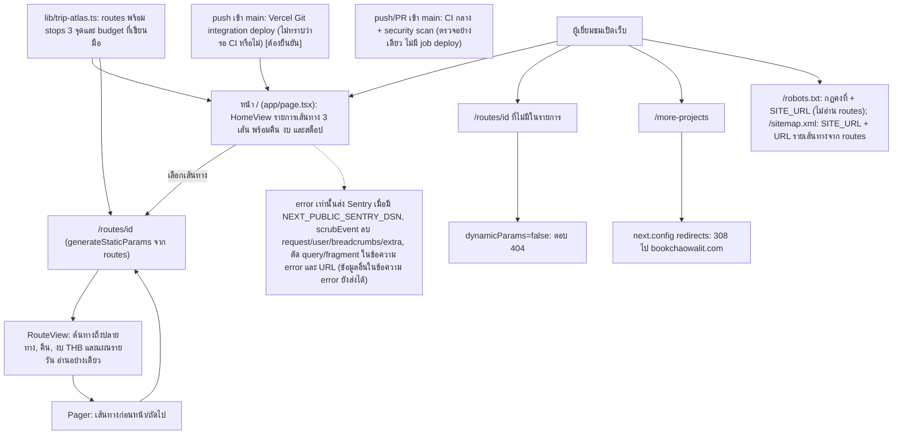

# 01 — Business process (As-Is / To-Be)

travel-trip-atlas-web (Trip Atlas) คือเว็บอ่านแผนเส้นทางท่องเที่ยวสำหรับผู้เยี่ยมชมหรือนักเดินทางที่อยากร่างทริปสั้นๆ แสดงเส้นทางสังเคราะห์ 3 เส้น (เหนือ ชายฝั่ง สิงคโปร์) พร้อมแผนรายวันและงบประมาณโดยประมาณ หน้าเว็บสร้างแบบ static จากข้อมูลในโค้ด ไม่มีการจอง แผนที่ ราคาสด หรือบัญชีผู้ใช้

Last reviewed: 2026-11-28 · commit `7f85e36`

## As-Is (จากโค้ดวันนี้)

Sources: `app/page.tsx`, `app/routes/[id]/page.tsx`, `components/atlas-views.tsx`, `lib/trip-atlas.ts`, `app/sitemap.ts`, `app/robots.ts`, `lib/site.ts`, `next.config.ts`, `lib/sentry.ts`, `instrumentation.ts`, `.github/workflows/ci.yml`

## To-Be (ไม่มี To-Be ที่เขียนไว้)

ไม่มี To-Be ที่เขียนไว้

## Gap

| ID | As-Is → To-Be | Status | Owner | Evidence |
|---|---|---|---|---|
| G1 | เดโมข้อมูลสังเคราะห์ที่ไม่มี roadmap → ต้องการเป้าหมายที่เขียนไว้ (คงเป็นเดโม หรือเพิ่มการจอง/ราคาจริง) | decide | owner | `PRODUCT.md` ระบุว่าไม่มีการจอง แผนที่ หรือข้อมูลสด และไม่มีเป้าหมายถัดไป |

## Open questions

- `README.md` และ `PRODUCT.md` ยังบรรยายหน้าเดียวแบบ client ที่กด "Mark next stop" และปุ่ม "Route complete" ได้ แต่โค้ดตอนนี้เป็นหน้า server render บน Reader shell: แผนรายวันเป็นรายการอ่านอย่างเดียว ไม่มีปุ่มก้าวไปสต็อปถัดไป: เอกสารล้าหลังโค้ด
- สถานะ deploy จริงของ Vercel ยืนยันจากโค้ดไม่ได้ [ต้องยืนยัน]
